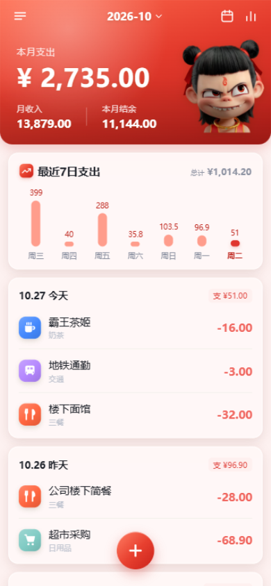
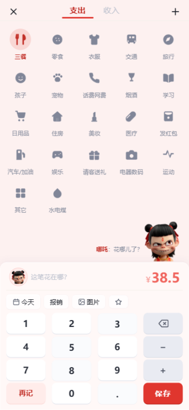
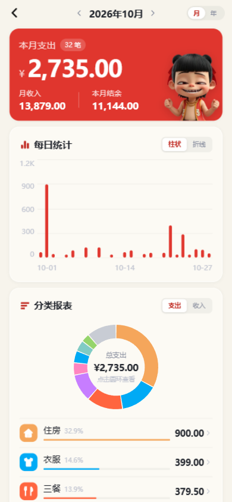
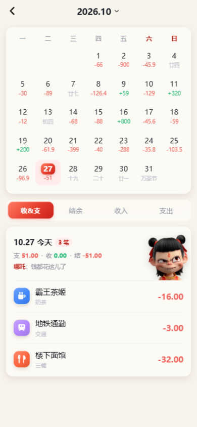
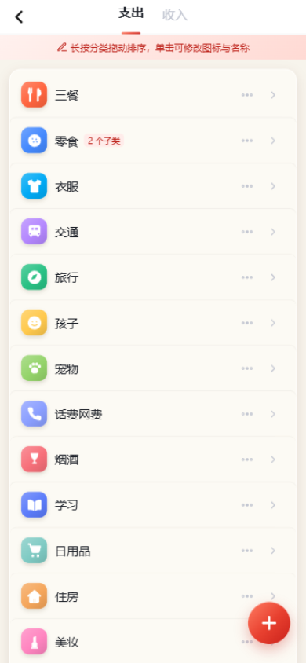
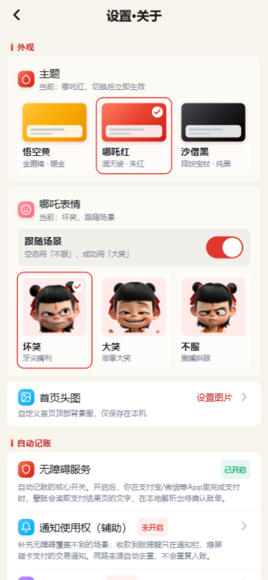

# 孽账

<p align="center"></p>

Android 双渠道自动记账 App（无障碍为主 + 通知监听辅助）。技术栈：**uni-app（vue3）+ UTS 插件（hybrid.kt 原生核心）**。

> 原生 Android 重写版在 [`android/`](android/README.md)，构建、签名与数据迁移见该目录 README；根目录 uni-app 工程保留用于对照/回滚。

界面布局参考【钱迹】，配色与视觉按本项目的三主题重做。

> 开发与 AI 协作的通用强约束见 [AGENTS.md](AGENTS.md)，按主题拆分的业务细则见 [docs/](docs/README.md)，改动前必读。

核心链路：支付结果页（无障碍采集窗口文字，主渠道）/ 支付类App通知（辅助渠道）→ 候选App白名单 → 解析金额/收支 → 单号/捕获级去重 → **底部确认弹层**（透明 Activity 从屏幕底部滑出，覆盖在支付页上方，可改金额/分类/备注）→ 用户点"保存"才入账。弹层不是悬浮窗、不落草稿：取消/返回/60 秒超时/弹层显示后熄屏都会直接丢弃这一笔；弹层从一开始就拉不起来（熄屏/锁屏、系统拦截后台启动 Activity）时，发一条「待确认」通知兜底，点开仍回到同一个确认弹层，通知本身不写库。注意 **MIUI/HyperOS 要求同时允许「显示在其他应用上层」和独立的「后台弹出界面」**（设置页拆成两项显示状态并各有入口，后者仅小米/Redmi/POCO 显示），否则系统会直接拦掉后台启动 Activity。主渠道不依赖对方 App 是否发系统通知，主动付款/转账也能捕获；辅助渠道覆盖收款到账提醒、熄屏碰卡交易通知。

## 界面预览

> 截图取自 H5 预览（哪吒红主题 + 演示数据），与 App 端各自独立；真机数据只存本机 SQLite。

<table align="center">
  <tr>
    <td align="center" width="33%"><br><sub>首页 · 本月概览与最近 7 日支出</sub></td>
    <td align="center" width="33%"><br><sub>记一笔 · 分类宫格与计算键盘</sub></td>
    <td align="center" width="33%"><br><sub>统计 · 每日柱状图与分类环形图</sub></td>
  </tr>
  <tr>
    <td align="center" width="33%"><br><sub>日历 · 农历角标与按日收支</sub></td>
    <td align="center" width="33%"><br><sub>分类管理 · 拖拽排序与子类</sub></td>
    <td align="center" width="33%"><br><sub>设置 · 三主题、角色表情与授权状态</sub></td>
  </tr>
</table>

## 目录结构

```
muyian/
├── App.vue / main.js / manifest.json / pages.json    # uni-app vue3 标准工程（pages.json 含 wot-design-uni easycom 配置）
├── package.json                                      # npm 依赖：wot-design-uni
├── common/
│   ├── cats.js                # 分类数据：默认分类播种/本地存储/图标与调色板/子类归并
│   ├── merchants.js           # 商户分类建议：内置词典（关键词→叶子名）+ 用户修正回流
│   ├── lunar.js               # 农历转换 + 节日（1900-2100，日历页角标）
│   ├── fmt.js                 # 金额千分位/日期工具/按日分组/金额表达式求值
│   ├── theme.js               # 主题清单/持久化/响应式主题类（悟空黄、哪吒红、沙僧黑）
│   ├── mascots.js             # 角色唯一来源：主题→角色映射、表情 mood、基础表情与跟随场景开关
│   └── recents.js             # 从最近任务隐藏（运行时 AppTask.setExcludeFromRecents，兼容 HyperOS）
├── components/
│   ├── bill-list/bill-list.vue   # 按日分组账单列表（首页与日历页复用）
│   └── mascot-face/mascot-face.vue # 通用角色表情（空态、抽屉头像、记一笔分类区/输入行；按主题/场景取图）
├── pages/                     # 全部自定义导航（wot-design-uni 组件库）
│   ├── index/index.vue        # 首页：渐变头图月概览 + 最近7日支出图 + 按日账单 + FAB
│   ├── add/add.vue            # 记一笔：分类宫格 + 备注/日期/报销/星标/图片 + 计算键盘；兼作账单编辑
│   ├── calendar/calendar.vue  # 日历：农历角标 + 收&支/结余/收入/支出四模式 + 按日账单
│   ├── stats/stats.vue        # 统计：收支总览 + 每日/每月柱状图 + 分类环形图（canvas）
│   ├── categories/categories.vue # 分类管理：长按排序/单击修改/子类增删/表情图标
│   └── settings/settings.vue  # 无障碍授权引导 + 通知权限 + 后台运行 + 主题/首页头图 + 隐私说明
└── uni_modules/muyian-bill-listener/   # UTS 插件（仅 Android）
    └── utssdk/
        ├── interface.uts              # API 声明（JSON 字符串协议）
        ├── app-android/
        │   ├── hybrid.kt              # 原生核心：AccessibilityService + 过滤 + 解析 + 去重 + SQLite + BillSheetActivity
        │   ├── index.uts              # 薄封装，调用 Kotlin 核心
        │   ├── AndroidManifest.xml    # 注册无障碍服务 + 通知监听服务 + 底部弹层 Activity
        │   └── res/                   # 无障碍服务配置 + 服务名称/描述字符串
        └── app-ios/index.uts          # iOS 桩（无对应系统能力）
```

## 数据设计

SQLite `files/muyian.db`，表 `bills(id, year, month, day, clock, money, bankName, costType, orderRemark, source, sourcePkg, createdAt, reimb, starred, orderNo)`。
`money` 支出为负、收入为正；`source` 为 `screen`（支付页解析，主渠道）、`notify`（通知解析，辅助渠道与历史数据）或 `manual`（手动）；`reimb` 报销标记、`starred` 星标、`orderNo` 订单/交易单号（旧库自动 ALTER 补列）。账单在底部确认弹层点"保存"后入账；取消/返回/超时直接丢弃，不落任何草稿。
分类体系存前端 `uni.storage`（`common/cats.js`）：一级分类 + 子类，账单 `costType` 存叶子名，统计时归并到一级。

去重四层（单号优先，无单号才逐级退回）：

1. 单号级：同订单/交易单号 24 小时窗口（页面重复渲染、通知更新、screen/notify 双路互防）；
2. 捕获级：无单号时 `包名|金额|页面文本头` 5 分钟窗口（SharedPreferences 持久化）；
3. 弹层层：同渠道 + 金额 + 2 分钟窗口（弹层还没保存前，另一路来源不重复弹；两边单号不同则视为两笔）；
4. 账单级：同上，查已入账的自动来源记录（同样按单号区分同金额的两笔交易）。

## 如何运行

1. 用 **HBuilderX 3.9+** 打开本项目，manifest.json 里重新获取一次 appid；
2. 连接 Android 真机（必须真机，模拟器通知场景不真实）；
3. 因为含 UTS 插件，**标准基座跑不了**：菜单「运行 → 运行到手机或模拟器 → 制作自定义调试基座」，打包完成后运行时选择「自定义基座」；
4. 启动后进「设置·关于」页：
   - 点「去开启」跳转系统"无障碍"设置页，开启「孽账自动记账」（Android 13+ 侧载应用若开关为灰色，先在应用信息中允许"受限设置"）；
   - 可选：开启「通知使用权（辅助）」，覆盖收款到账提醒、熄屏碰卡交易通知；
   - 点「请求通知权限」（Android 13+），用于「后台保活」常驻通知和弹层拉不起来时的「待确认」通知；
   - **「显示在其他应用上层」和「后台弹出界面」都必须允许**：这是 MIUI/HyperOS 的两个独立开关，设置页分别显示状态（后者仅小米/Redmi/POCO 显示）；只开前者时付款后弹层会被系统直接拦掉，被拦后只能收到待确认通知（只开系统开关，不绘制悬浮窗）；
   - 在「后台运行」分组把「电池优化」设为"不限制"（首页也有提示条）；需要常驻时保持「后台保活」开启（默认开启，前台服务 + 低优先级通知）；「从多任务页面隐藏」默认开启（系统一键清理不会连带清掉本应用任务）；国产 ROM 再按需在「自启动 / 后台管理」里允许自启动；
5. 真实验证：在支付宝/微信里支付或转账一笔，支付成功页面出现后 1 秒左右应从屏幕底部滑出记账弹层；点「保存」入账，点「取消」/返回键丢弃。熄屏/锁屏或未允许「后台弹出界面」时付款，应收到一条「待确认」通知；点通知仍进同一个确认弹层，取消后通知同步消失。
6. 首页按返回键不会退出应用，而是回到桌面继续在后台运行；再次打开即恢复。

## 首次编译注意

- UTS 插件在原生层用 `hybrid.kt`（纯 Kotlin + Android 框架 API，无第三方依赖），所有跨语言 API 用 **JSON 字符串进出**，规避 UTS number ↔ Kotlin Int/Double 的类型映射问题；
- 如果云打包报 Kotlin/Manifest 相关错误，优先检查 `uni_modules/muyian-bill-listener/utssdk/app-android/` 下三个文件的语法；
- 服务注册在插件 Manifest 中以全限定名 `muyian.bill.listener.MuyianBillAccessibilityService` 声明，不依赖 UTS 生成包名的约定；无障碍服务配置在插件 `res/xml/muyian_accessibility_config.xml`。
